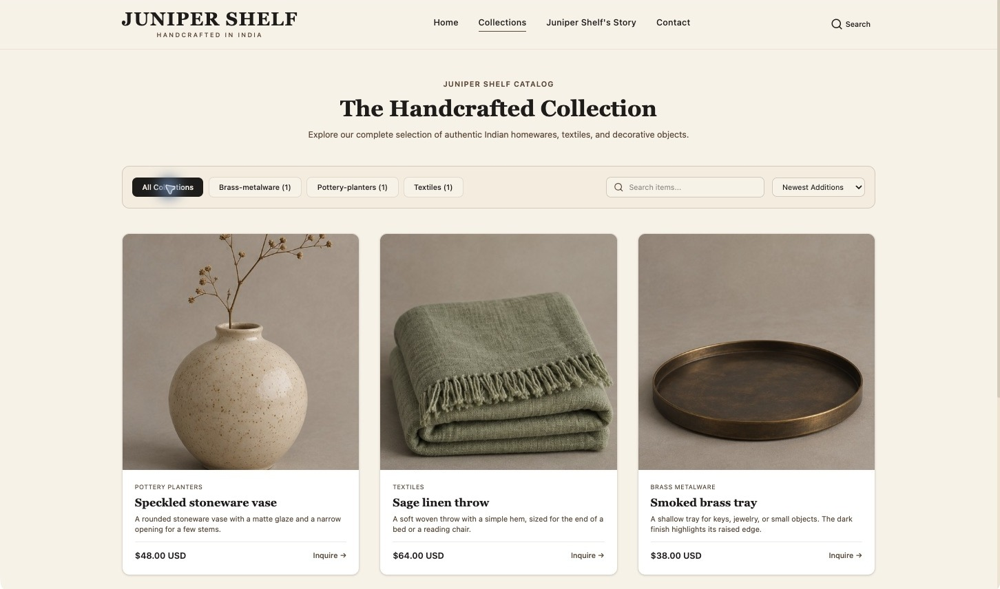
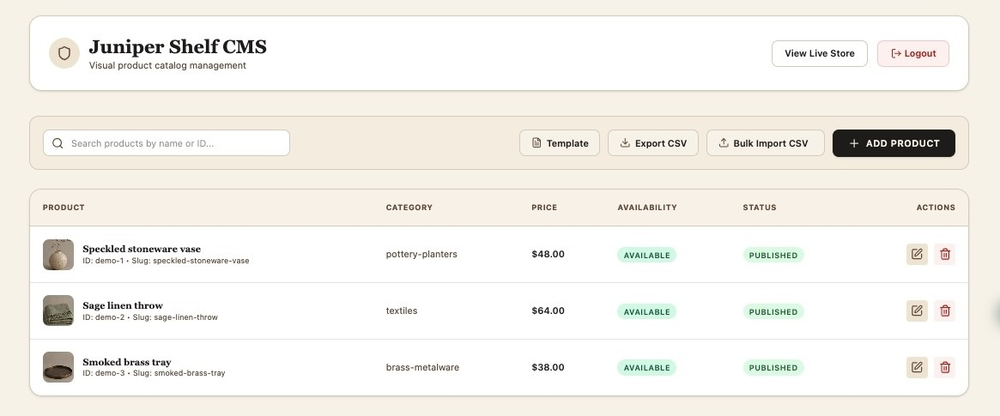
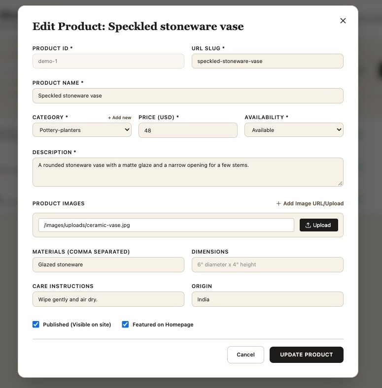

# How I built a local catalog editor for Juniper Shelf

*How I used a local content editor, GitHub, and Cloudflare Pages to publish a small catalog.*

Juniper Shelf is a fictional name for a catalog I built for a small business. The public site is a React single-page application. Visitors can browse products and view their photos without the site running an application server or database. The shop still needed a way to add photos and change descriptions without editing JSON by hand. I built a visual editor for that work and kept the content files in Git alongside the storefront.

## How product photos reach the browser

The catalog lives in `public/products.json`. Each product can reference several images by URL and include alternative text. The listing uses the first photo, and the product page lets visitors select from the gallery.

When an editor adds a photo, the admin page converts HEIC or HEIF uploads to JPEG in the browser. The local Express server saves the uploaded file under `public/images/uploads/` with a generated filename and returns its URL. Saving the product records that URL in the catalog JSON. The JSON contains references to image files, so browsing the catalog doesn’t require downloading the photo data with the product list.

Vite copies the files in `public/` into the production build. Cloudflare Pages serves those files alongside the application bundle. The browser loads the catalog JSON and requests each image as a separate static asset. An uploaded photo is served from the site’s own asset path, without a live image API or a connection to the editor’s computer.

<figure>
  
  <figcaption>The storefront loads product photos as separate static files. The sample products are fictional, and their photos were generated for this demo.</figcaption>
</figure>

## How the admin editor works

The editor is a React view that I run on a local machine with the project checked out. The local Node.js and Express process serves the development app and handles catalog writes and uploads. The editor has a login screen, a product form, photo upload and ordering controls, and CSV import and export for bulk editing.

<figure>
  
  <figcaption>The local dashboard gives the editor a place to review the catalog and open a product for editing.</figcaption>
</figure>

When I open the catalog locally, the frontend can read from the Express API so I can review edits in the browser. The deployed SPA falls back to the bundled `products.json` and loads the photos through their static URLs. The public deployment contains the generated site files. It doesn’t run the local Express write API. The boundary is the deployment itself. A login screen or a hidden admin link wouldn’t make a public write API private.

<figure>
  
  <figcaption>The product editor keeps the description and image references together before saving them to the local checkout.</figcaption>
</figure>

## From a local edit to the live site

1. **Edit locally.** Open the admin editor and change the description, update product fields, or add and reorder photos. Saving a product updates the JSON in the working copy. Uploaded photos are files in the same checkout.
2. **Preview the catalog.** Check the listing and detail view. Confirm that the right photo appears first and every image referenced by the JSON loads.
3. **Commit the content.** Review the Git diff and commit the JSON and any new or replaced images together. Push the changes to the connected GitHub repository. A local save is still private to the working copy until the files are published.
4. **Deploy from GitHub.** When the change reaches the production branch, Cloudflare Pages runs `npm run build` and serves the resulting `dist/` directory. The catalog data, photos, and frontend ship as one deployment. A preview branch can provide a separate site to review before merging. [Cloudflare Pages Git integration](https://developers.cloudflare.com/pages/get-started/git-integration/)
5. **Check the live page.** Open the published listing and product page and verify the updated text and photos. If a photo is missing, check that its path appears in the JSON and that the corresponding file was included in the same commit.

## What I gained and what it costs

Keeping content in Git gives me a record of what shipped and lets me review a change to a product and its images together. It also keeps the public setup small. Cloudflare serves a build output, and the editor and its write API run only where I do the editing.

### Where this setup falls short

- **Changes wait for a deploy.** Saving in the local editor updates the checkout. Customers see the change only after the files are pushed and Cloudflare finishes a successful build. That delay is acceptable for occasional catalog changes. It becomes a problem if prices or stock need to update immediately.
- **Editors can overwrite each other’s changes.** Each editor needs a local checkout and a way to publish through Git. If two people update the same product from separate checkouts, they have to reconcile the JSON changes before publishing. The editor has no shared draft or review queue.
- **Photos add weight to Git and to the page.** The project stores uploaded files in the repository, so replacing photos can grow its history over time. The storefront serves the uploaded files as static assets. Large uploads can still slow down the gallery on a mobile connection.
- **The catalog shows the last published snapshot.** Product availability comes from the catalog JSON. The site has no live inventory feed, checkout, or reservation system to update that status when someone buys a product.
- **Static files are public.** A product hidden in the storefront can still be present in the published JSON, and a direct photo URL can still work. I have to leave confidential drafts and images out of the build entirely.

I’d keep this setup for a small catalog with one editor and occasional updates. If several people needed to publish independently, I’d look at a managed CMS. If the image library became hard to manage in Git, I’d move photos to object storage.
